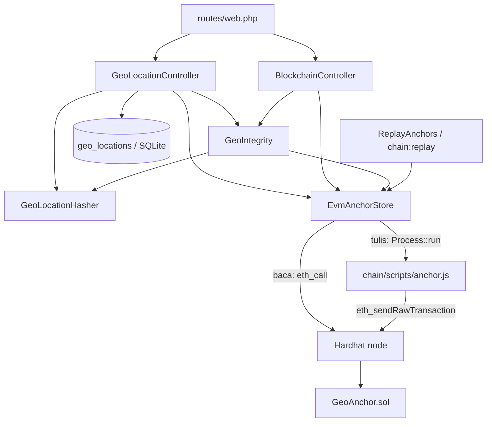
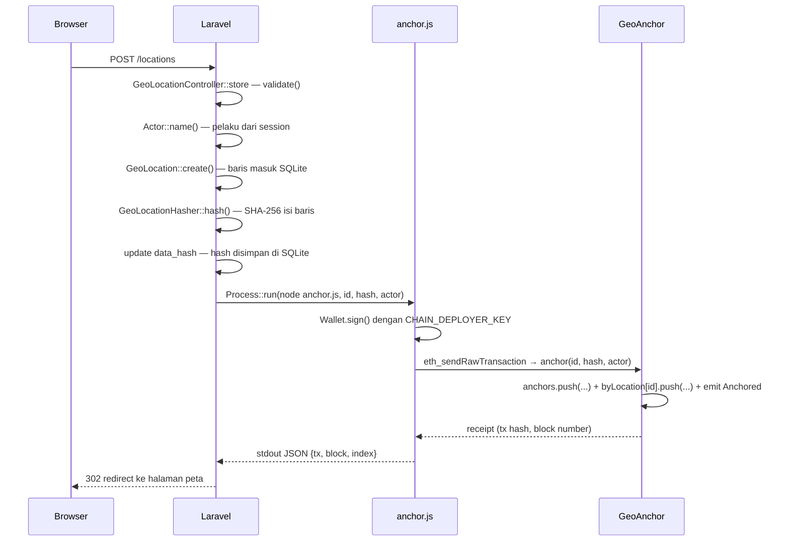
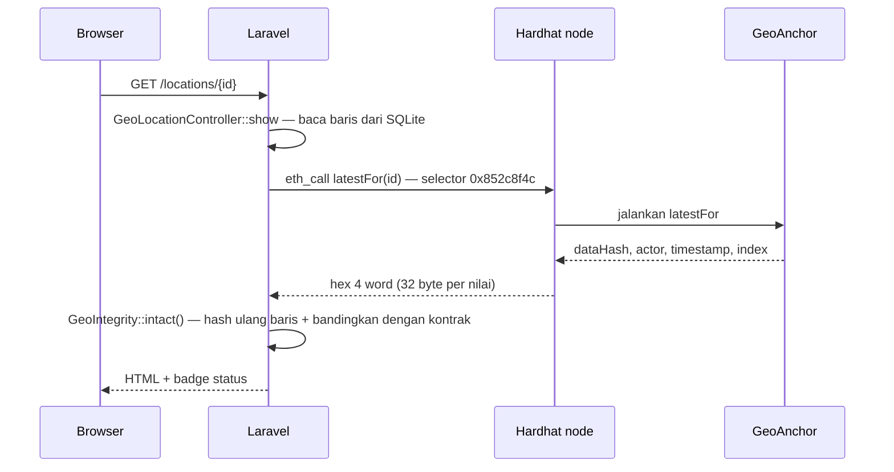

# Alur Blockchain GeoIntegrity

Dokumen ini menjelaskan alur sistem dengan dua cara: **narasi** (bagian 4–7),
lalu **diagram** sebagai lampiran (bagian 12). Fokusnya tiga file inti:

| File | Peran dalam satu kalimat |
|---|---|
| `app/Services/GeoLocationHasher.php` | mengubah isi satu titik peta menjadi sidik jari 64 karakter |
| `chain/contracts/GeoAnchor.sol` | menyimpan sidik jari itu secara permanen dan tidak bisa diubah |
| `app/Services/GeoIntegrity.php` | menghitung ulang sidik jari dan memutuskan data masih utuh atau tidak |

File lain (`EvmAnchorStore`, `anchor.js`, controller, Blade) hanya penghubung
antara ketiganya. Untuk instalasi, lihat [SETUP.md](SETUP.md).

---

## Ringkasan 60 detik

| # | Aksi | File |
|---|---|---|
| 1 | form dikirim | `routes/web.php` → `GeoLocationController::store` |
| 2 | hash isi baris dibuat | `GeoLocationHasher::hash` |
| 3 | hash disimpan di SQLite (`data_hash`) | model `GeoLocation` |
| 4 | minta tulis ke kontrak | `EvmAnchorStore::anchor` |
| 5 | transaksi ditandatangani & dikirim | `chain/scripts/anchor.js` → `GeoAnchor.anchor()` |
| 6 | nanti: hash dihitung ulang & dibandingkan | `GeoIntegrity::intact` → badge di `locations/show.blade.php` |

---

## 1. Empat lapisan sistem

| Lapisan | Teknologi | Tugas | File utama |
|---|---|---|---|
| 1. Browser | HTML + Leaflet | form titik, peta, halaman detail | `resources/views/**` |
| 2. Aplikasi | PHP / Laravel | validasi, simpan data, hitung hash, tampilkan status | `app/**` |
| 3. Penghubung | PHP → Node (proses) + HTTP JSON-RPC | menandatangani transaksi, membaca kontrak | `EvmAnchorStore`, `chain/scripts/*.js` |
| 4. Blockchain | Solidity + Hardhat node | menyimpan hash permanen (append-only) | `chain/contracts/GeoAnchor.sol` |

Nama, deskripsi, dan koordinat titik tidak pernah masuk ke lapisan 4. Yang
dikirim hanya 32 byte hash.

---

## 2. Siapa memanggil siapa

| File | Peran | Dipanggil oleh | Memanggil |
|---|---|---|---|
| `routes/web.php` | daftar URL | browser | controller |
| `GeoLocationController` | orkestrasi request titik | route | `GeoLocationHasher`, `EvmAnchorStore`, `GeoIntegrity`, model |
| `GeoLocationHasher` | membuat hash isi baris | controller, `GeoIntegrity` | — (fungsi murni) |
| `EvmAnchorStore` | jembatan ke kontrak | controller, `GeoIntegrity`, `chain:replay` | `anchor.js` (tulis), JSON-RPC `eth_call` (baca) |
| `chain/scripts/anchor.js` | tanda tangan + kirim transaksi | `EvmAnchorStore` | `GeoAnchor.sol` via JSON-RPC |
| `GeoAnchor.sol` | simpan anchor | `anchor.js` (tulis), `EvmAnchorStore` (baca) | — |
| `GeoIntegrity` | memutuskan valid/tidak | controller | `EvmAnchorStore`, `GeoLocationHasher` |
| `BlockchainController` | `/chain`, `/chain/verify`, `/chain/proof` | route | `EvmAnchorStore`, `GeoIntegrity` |
| `Actor` | identitas demo A/B/C | controller | model `User` |
| `chain/scripts/deploy.js` | memasang kontrak | dijalankan manual | `GeoAnchor.sol` |
| `ReplayAnchors` (`chain:replay`) | tulis ulang semua anchor | dijalankan manual | `EvmAnchorStore` |



---

## 3. Tiga file inti, satu paragraf masing-masing

`GeoLocationHasher` adalah pembuat identitas. Ia menerima satu baris
`GeoLocation`, mengambil seluruh kolomnya, membuang dua kolom yang tidak boleh
ikut dihitung (`data_hash` karena akan merujuk dirinya sendiri, dan `updated_at`
karena Laravel menulis ulang kolom itu pada setiap penyimpanan — termasuk
penyimpanan yang menyimpan hash itu sendiri), merapikan nilai desimal dan tanggal
agar bentuknya sama setiap kali dibaca, mengurutkan kunci, lalu mengembalikan
SHA-256 dari JSON-nya sebagai 64 karakter hex. Hasilnya bukan "hash dari beberapa
field penting", melainkan hash dari **semua** field, sehingga kolom yang
ditambahkan nanti otomatis ikut terlindungi.

`GeoAnchor.sol` adalah tempat penyimpanan yang tidak bisa diubah. Ia hanya punya
satu cara masuk: fungsi `anchor(locationId, dataHash, actor)` yang menambahkan
satu entri ke array `anchors`, mencatat indeksnya di `byLocation[locationId]`,
dan memancarkan event `Anchored`. Tidak ada fungsi untuk mengubah atau menghapus
entri, tidak ada jalur untuk mengganti hash lama. Waktu dicatat dari
`block.timestamp` milik node, dan nama pelaku disimpan sebagai `bytes32` (maksimal
31 byte, karena `encodeBytes32String` memakai satu byte terakhir sebagai
terminator) supaya semua nilai yang dibaca bisa diurai tanpa library ABI.

`GeoIntegrity` adalah hakimnya. Ia membaca hash yang tersimpan di kontrak lewat
`EvmAnchorStore::latest()`, menghitung ulang hash baris yang sekarang ada di
SQLite lewat `GeoLocationHasher`, lalu menyatakan data utuh hanya kalau **dua**
syarat terpenuhi: kolom `data_hash` di database masih sama dengan hash di
kontrak, dan hash hasil hitung ulang juga sama dengan hash di kontrak. Syarat
pertama menangkap orang yang menulis ulang kolom `data_hash`; syarat kedua
menangkap orang yang mengubah isi titik. Kalau salah satu gagal, hasilnya
"tidak valid".

---

## 4. Alur pembuatan anchor

Semuanya dimulai ketika User A mengisi form dan menekan Simpan. Browser mengirim
`POST /locations`, `routes/web.php` meneruskannya ke
`GeoLocationController::store`, dan di sanalah urutan yang menentukan dimulai.
Urutan tiga pemanggilan itulah yang menentukan: simpan baris → hitung hash →
anchor. Potongan kode di bawah tiap paragraf adalah bagian yang benar-benar
menjalankan langkah tersebut.

Langkah pertama masih murni aplikasi: input divalidasi, `Actor::name()` membaca
siapa yang sedang aktif dari session, lalu `GeoLocation::create()` menulis baris
baru ke SQLite dengan `created_by` dan `updated_by` terisi. Pada titik ini
database sudah punya data, tetapi belum ada satu pun hal yang bersifat
kriptografis.

```php
// app/Http/Controllers/GeoLocationController.php — store()
$location = GeoLocation::create($validated + [
    'created_by' => Actor::name(),
    'updated_by' => Actor::name(),
]);

$location->update(['data_hash' => $hasher->hash($location)]);

$store->anchor($location->id, $location->data_hash, Actor::name());
```

Langkah kedua menyerahkan baris itu kepada `GeoLocationHasher`. Karena hash
dihitung dari seluruh kolom, hasilnya bergantung pada id, nama, deskripsi,
koordinat, pembuat, pengubah, dan waktu pembuatan sekaligus. Hash inilah yang
kemudian ditulis kembali ke kolom `data_hash` pada baris yang sama. Perlu
diperhatikan bahwa kolom itu hanya **salinan lokal** untuk ditampilkan; sumber
kebenarannya tetap kontrak.

```php
// app/Services/GeoLocationHasher.php
public function hash(GeoLocation $location): string
{
    $data = $location->getAttributes();

    unset($data['data_hash'], $data['updated_at']);

    $data['latitude'] = number_format((float) $data['latitude'], 7, '.', '');
    $data['longitude'] = number_format((float) $data['longitude'], 7, '.', '');

    foreach ($data as $key => $value) {
        if ($value instanceof \DateTimeInterface) {
            $data[$key] = $value->format('Y-m-d H:i:s');
        }
    }

    ksort($data);

    return hash(
        'sha256',
        json_encode(
            $data,
            JSON_UNESCAPED_UNICODE | JSON_UNESCAPED_SLASHES
        )
    );
}
```

Langkah ketiga adalah menyeberang ke blockchain, dan di sini peran `GeoAnchor`
mulai terlihat. `GeoLocationController` memanggil `EvmAnchorStore::anchor()`
dengan tiga argumen: id titik, hash tadi, dan nama pelaku. Karena PHP di proyek
ini tidak punya pustaka untuk menandatangani transaksi, `EvmAnchorStore`
menjalankan `node chain/scripts/anchor.js` sebagai proses terpisah. Skrip itu
membuka koneksi ke node Hardhat, membentuk transaksi `anchor(id, hash, actor)`
dengan akun deployer, menandatanganinya, dan mengirimkannya.

```php
// app/Services/EvmAnchorStore.php — anchor()
$result = Process::path(base_path())
    ->env($env)                 // env host + CHAIN_RPC_URL/CONTRACT/DEPLOYER_KEY
    ->timeout(60)
    ->run([
        config('chain.node_bin'),      // node
        config('chain.write_script'),  // chain/scripts/anchor.js
        (string) $locationId,
        $dataHash,
        $actor ?? 'Anonim',
    ]);
```

```js
// chain/scripts/anchor.js
const contract = new ethers.Contract(address, [
    "function anchor(uint256 locationId, bytes32 dataHash, bytes32 actor) returns (uint256)",
], wallet);

const hash = dataHash.startsWith("0x") ? dataHash : "0x" + dataHash;
const actorBytes = ethers.encodeBytes32String(actor);

const tx = await contract.anchor(BigInt(locationId), hash, actorBytes);
const receipt = await tx.wait();
```

Di dalam kontrak, transaksi itu berakhir sebagai satu entri baru: hash tersimpan
di `anchors`, indeksnya dicatat per titik, dan event `Anchored` dipancarkan.
Setelah node mengembalikan receipt, `anchor.js` mencetak ringkasan `{tx, block,
index}` ke stdout, `EvmAnchorStore` membacanya, dan request Laravel selesai
dengan redirect ke halaman peta. Sejak saat itu, hash yang sama tersimpan di dua
tempat dengan kekuatan berbeda: satu salinan di SQLite yang bisa diubah, satu
salinan di kontrak yang tidak.

```solidity
// chain/contracts/GeoAnchor.sol
function anchor(uint256 locationId, bytes32 dataHash, bytes32 actor)
    external
    returns (uint256 index)
{
    index = anchors.length;
    uint64 ts = uint64(block.timestamp);

    anchors.push(Anchor(locationId, dataHash, actor, ts));
    byLocation[locationId].push(index);

    emit Anchored(locationId, dataHash, actor, index, ts);
}
```

Perhatikan tidak ada fungsi `update` atau `delete` di kontrak: satu-satunya jalan
masuk adalah `anchor()`, dan setiap pemanggilan menambah entri baru.

Perlu dicatat satu hal penting untuk presentasi: kalau langkah ketiga gagal
(misalnya node mati), data titik tetap tersimpan tetapi titik itu berstatus
"Belum terdaftar" di blockchain. Tidak ada rollback otomatis.

---

## 5. Alur pemeriksaan

Beberapa waktu kemudian User B mengubah longitude titik tersebut. Perhatikan apa
yang **tidak** terjadi: `GeoLocationController::update` menyimpan perubahan dan
memperbarui `updated_by`, tetapi ia sengaja tidak menghitung ulang hash dan tidak
memanggil `GeoAnchor`. Akibatnya kolom `data_hash` masih berisi hash lama — hash
yang sama dengan yang ada di kontrak — sementara isi barisnya sudah berbeda.

```php
// app/Http/Controllers/GeoLocationController.php — update()
$geoLocation->update($validated + ['updated_by' => Actor::name()]);

// sengaja tidak ada di sini:
//   $geoLocation->update(['data_hash' => $hasher->hash($geoLocation)]);
//   $store->anchor(...);
// Justru ketidakhadiran dua baris itu yang membuat perubahan terdeteksi.
```

Ketika User C membuka `/locations/{id}`, `GeoLocationController::show` mengambil
baris dari SQLite, lalu bertanya kepada `GeoIntegrity`. `GeoIntegrity` meminta
hash yang tercatat ke kontrak melalui `EvmAnchorStore::latest()`, yang melakukan
`eth_call` ke fungsi `latestFor(id)` dan mengurai balasan hex menjadi empat nilai
32-byte: hash, pelaku, waktu, dan indeks. Nilai inilah yang tidak bisa dipengaruhi
oleh siapa pun yang mengubah database.

```php
// app/Http/Controllers/GeoLocationController.php — show()
$anchor = $integrity->latest($geoLocation);
$hashMatches = $anchor === null ? null : $integrity->intact($geoLocation, $anchor);
```

```php
// app/Services/EvmAnchorStore.php — latest()
$words = $this->call('latestFor', $this->uintWord($locationId)); // eth_call

return [
    'data_hash' => '0x'.substr($words[0], 0, 64),
    'actor' => $this->fromBytes32($words[1]),
    'timestamp' => $this->toInt($words[2]),
    'index' => $this->toInt($words[3]),
    'tx' => null,
];
```

Setelah hash anchor didapat, `GeoIntegrity` melakukan dua pembandingan yang sudah
disebut di bagian 3. Kolom `data_hash` masih cocok (karena update tidak
menyentuhnya), tetapi hash hasil hitung ulang sudah berbeda karena longitude
berubah. Syarat kedua gagal, jadi `intact()` mengembalikan `false`, dan Blade
menampilkan badge *Hash tidak valid* beserta keterangan bahwa data berubah setelah
anchor dan credential tidak bisa di-anchor ulang.

```php
// app/Services/GeoIntegrity.php — intact()
$anchored = $this->normalize($anchor['data_hash']);

return $this->normalize($location->data_hash) === $anchored   // kolom tidak diubah
    && $this->hasher->hash($location) === $anchored;          // isi tidak diubah
```

Kalau titik itu tidak pernah punya anchor sama sekali, `latest()` mengembalikan
`null` (kontrak menolak `latestFor` untuk id yang belum terdaftar), dan hasilnya
badge ketiga: *Belum terdaftar*. Inilah tiga kemungkinan status yang dilihat
pengguna, dan ketiganya berasal dari satu keputusan di `GeoIntegrity`.

```blade
{{-- resources/views/locations/show.blade.php --}}
@if ($hashMatches === null)
    <span class="badge bad">Belum terdaftar di blockchain</span>
@elseif ($hashMatches)
    <span class="badge ok">Hash cocok — data tidak diubah</span>
@else
    <span class="badge bad">Hash tidak valid — data diubah setelah anchor</span>
@endif
```

---

## 6. Alur `/chain` dan `/chain/verify`

Halaman `/chain` adalah cara melihat isi kontrak secara langsung.
`BlockchainController::index` meminta `EvmAnchorStore::all()`, yang pertama
memanggil `total()` untuk mengetahui jumlah anchor, lalu memanggil `anchorAt(i)`
untuk setiap indeks dari yang terbaru ke terlama. Satu anchor berarti satu
`eth_call`; dengan empat titik saat ini, satu halaman menghasilkan enam panggilan
(1 `total` + 4 `anchorAt` + 1 `total` untuk status). Cukup untuk demo, bukan untuk
ribuan anchor.

Endpoint `/chain/verify` melakukan pemeriksaan menyeluruh, dan di sini
`GeoIntegrity::audit()` mengambil alih:

```
BlockchainController@verify
  ├─ EvmAnchorStore::status()      → kontrak terjangkau? berapa anchor?
  └─ GeoIntegrity::audit()
       └─ untuk setiap baris geo_locations:
            ├─ latest()            → hash yang tercatat di kontrak
            └─ intact()            → cocok / tidak
       → {checked, tampered:[{id, name, reason}]}
```

Setiap baris yang gagal dicatat dengan alasan `unregistered` (belum pernah
di-anchor) atau `hash_mismatch` (isinya berubah). Hasilnya satu objek JSON:

```json
{"valid":true,"blocks":4,"driver":"evm","data":{"checked":4,"tampered":[]}}
```

Jadi `valid` berbicara tentang kontrak (terjangkau dan konsisten), sedangkan
`data.tampered` berbicara tentang isi database.

---

## 7. Setelah node Hardhat di-restart

Node Hardhat menyimpan state di memori. Begitu dimatikan, kontraknya kosong,
walaupun SQLite masih utuh. Karena kontrak baru dipasang di alamat yang sama
pada node yang masih bersih, urutan pemulihannya adalah: jalankan node, deploy
ulang kontrak, lalu `php artisan chain:replay`.

Perintah itu bekerja dengan logika yang sama seperti pembuatan anchor, hanya
sumbernya berbeda:

```
ReplayAnchors@handle
  └─ untuk setiap geo_locations:
       ├─ latest()                    → sudah sama? lewati (idempotent)
       └─ EvmAnchorStore::anchor()    → tulis ke kontrak
```

Perintah ini tidak dipakai untuk "memperbaiki" titik yang datanya sudah diubah.
Titik seperti itu tetap tidak valid: yang ditulis ulang adalah hash lama yang
tersimpan di kolom `data_hash`, bukan hash dari data yang sudah berubah.

---

## 8. Kalau ditanya "mana bagian blockchain-nya?"

| Peran | File | Inti kode |
|---|---|---|
| membuat hash | `app/Services/GeoLocationHasher.php` | `hash('sha256', json_encode($data))` |
| menyimpan permanen | `chain/contracts/GeoAnchor.sol` | `anchors.push(...)` |
| memutuskan valid | `app/Services/GeoIntegrity.php` | `hash ulang === hash kontrak` |

Urutan file yang dibuka saat presentasi: `GeoLocationHasher` → `GeoAnchor.sol` →
`GeoIntegrity` → `EvmAnchorStore::anchor()` → `anchor.js`.

---

## 9. Konsep dalam empat kalimat

1. Setiap baris titik punya **sidik jari** (hash SHA-256 dari seluruh isinya).
2. Sidik jari itu dicatat ke **kontrak yang tidak punya fungsi ubah/hapus**.
3. Saat diperiksa, sidik jari dihitung ulang dan **dibandingkan dengan salinan di
   kontrak**.
4. Kalau beda → data berubah setelah dicatat; kalau titik tidak punya catatan →
   belum pernah di-anchor.

Analogi: sidik jari data + buku notaris yang halamannya hanya bisa ditambah.

---

## 10. Yang sering ditanyakan

| Pertanyaan | Jawaban singkat |
|---|---|
| Hash itu apa? | Sidik jari matematis 64 karakter hex, tidak bisa dibalik ke data aslinya. |
| Kenapa tidak simpan hash di database saja? | Yang mengubah data juga bisa mengubah hash-nya. Yang dibandingkan harus dari kontrak. |
| Data peta masuk blockchain? | Tidak. Hanya 32 byte hash per titik; nama/koordinat tetap di SQLite. |
| Ada mining / token / gas? | Tidak. Node lokal Hardhat, konsensus instan, tanpa biaya. |
| Kenapa perlu Node.js? | Menandatangani transaksi butuh library kripto (ethers); PHP di proyek ini tidak punya. |
| Bisa anchor ulang setelah data diubah? | Tidak, dari web. Hanya `chain:replay` untuk memulihkan setelah node restart. |
| Kalau kontrak diganti orang lain? | Alamat kontrak ada di `.env`; kontrak lama tetap tidak bisa diubah, dan alamat baru terlihat di riwayat blok. |

---

## 11. Peta file

```
app/
├─ Http/Controllers/
│  ├─ GeoLocationController.php   index, store (anchor), show (verifikasi), update
│  └─ BlockchainController.php    /chain, /chain/verify, /chain/proof
├─ Services/
│  ├─ GeoLocationHasher.php       SHA-256 isi baris          ← inti 1
│  ├─ GeoIntegrity.php            intact() + audit()          ← inti 3
│  └─ EvmAnchorStore.php          baca eth_call, tulis via anchor.js
├─ Console/Commands/ReplayAnchors.php   php artisan chain:replay
├─ Support/Actor.php              identitas demo A/B/C
└─ Models/GeoLocation.php         tabel geo_locations (SQLite)

chain/
├─ contracts/GeoAnchor.sol        penyimpanan anchor          ← inti 2
├─ scripts/deploy.js              pasang kontrak ke node lokal
├─ scripts/anchor.js              tanda tangan + kirim transaksi
├─ hardhat.config.js              solc 0.8.24, network localhost
└─ test/GeoAnchor.test.js         6 test kontrak

resources/views/
├─ locations/index.blade.php      peta + form + tabel status
├─ locations/show.blade.php       detail + panel credential
└─ blockchain/index.blade.php     daftar anchor dari kontrak

tests/
├─ Feature/BlockchainTest.php     alur anchor & deteksi perubahan
├─ Feature/DemoTraceabilityTest.php  skenario A buat, B ubah, C deteksi
├─ Unit/EvmAnchorStoreTest.php    encode/decode 32-byte word
└─ Support/FakeAnchorStore.php    kontrak palsu untuk test
```

---

## 12. Lampiran — diagram urutan

Dipakai kalau ada yang minta gambaran visual setelah narasi di bagian 4–5.




