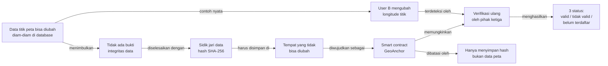
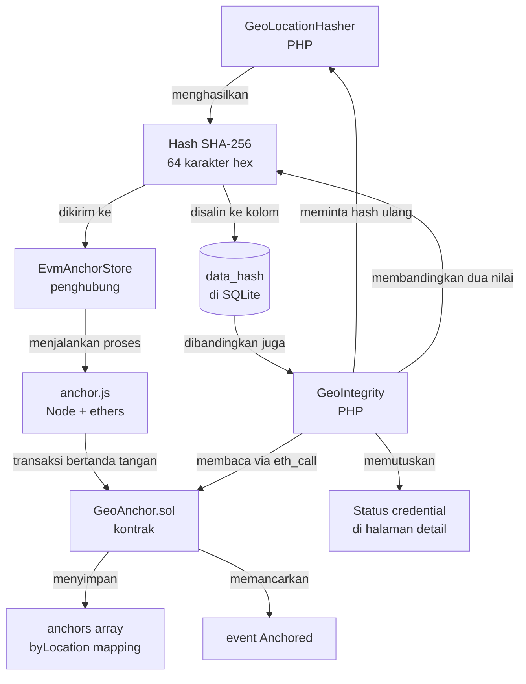
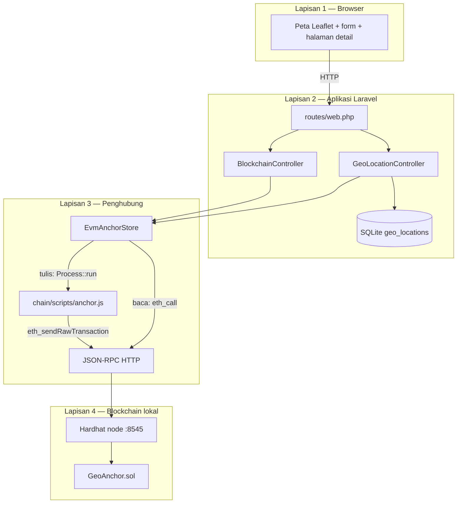

# Peta Konsep Proyek GeoIntegrity

Dokumen ini untuk **memahami dan menjelaskan** proyek, bukan untuk menulis isi
laporan. Kerangka tulisannya ada di [KERANGKA-LAPORAN.md](KERANGKA-LAPORAN.md);
alur teknis lengkap ada di [ALUR-BLOCKCHAIN.md](ALUR-BLOCKCHAIN.md).

Cara pakai: baca tiga peta di bawah, lalu pakai tabel konsep (bagian 4) sebagai
"kamus" saat menulis bab landasan teori.

---

## 1. Peta konsep masalah → solusi

Menjawab: *kenapa proyek ini ada?*

Inti yang harus dipahami: masalahnya bukan "butuh blockchain", tetapi "butuh
tempat menyimpan bukti yang tidak bisa diubah oleh pihak yang datanya diuji".

---

## 2. Peta konsep teknis (tiga file inti)

Menjawab: *bagian mana melakukan apa?*

Baca panah sebagai kalimat: *GeoLocationHasher menghasilkan hash; hash disalin ke
kolom data_hash dan dikirim ke EvmAnchorStore; EvmAnchorStore menjalankan
anchor.js; anchor.js mengirim transaksi ke GeoAnchor.sol; GeoIntegrity membaca
kontrak dan meminta hash ulang ke GeoLocationHasher, lalu membandingkan keduanya.*

---

## 3. Peta konsep sistem (empat lapisan)

Menjawab: *apa saja bagian besar sistemnya dan bagaimana mereka terhubung?*

Aturan yang membedakan lapisan 2 dan 4: **data peta hanya hidup di lapisan 2**;
lapisan 4 hanya menyimpan 32 byte hash per titik.

---

## 4. Kamus konsep (untuk bab landasan teori)

| Konsep | Definisi satu kalimat | Muncul di kode |
|---|---|---|
| Integritas data | Jaminan bahwa data tidak berubah sejak dicatat | seluruh sistem |
| Fungsi hash kriptografis | Fungsi satu arah yang memetakan data apa pun menjadi sidik jari berukuran tetap | `GeoLocationHasher` |
| SHA-256 | Algoritma hash 256-bit, keluaran 64 karakter hex | `GeoLocationHasher::hash` |
| Anchor | Tindakan mencatat hash ke penyimpanan permanen | `EvmAnchorStore::anchor` |
| Append-only | Struktur data yang hanya bisa ditambah, tidak diubah/dihapus | `GeoAnchor.sol` |
| Smart contract | Program yang berjalan di blockchain dan menyimpan state | `GeoAnchor.sol` |
| EVM | Mesin virtual yang mengeksekusi smart contract | Hardhat node |
| Solidity | Bahasa pemrograman smart contract | `GeoAnchor.sol` |
| Hardhat | Toolchain untuk compile, test, deploy, dan menjalankan node lokal | folder `chain/` |
| JSON-RPC | Protokol pemanggilan fungsi node blockchain lewat HTTP | `EvmAnchorStore::call` |
| `eth_call` | Panggilan baca ke kontrak tanpa transaksi dan tanpa biaya | `EvmAnchorStore` |
| Tanda tangan transaksi | Bukti kriptografis bahwa transaksi dibuat pemilik private key | `anchor.js` (ethers) |
| `bytes32` | Tipe data 32 byte, dipakai untuk hash dan nama pelaku | `GeoAnchor.sol` |
| Verifikasi | Menghitung ulang hash dan membandingkannya dengan yang di-anchor | `GeoIntegrity::intact` |
| Audit | Verifikasi menyeluruh untuk semua titik | `GeoIntegrity::audit` |
| Credential | Status keabsahan satu titik terhadap anchor-nya | halaman detail |

---

## 5. Tiga kalimat yang merangkum proyek

1. Data titik peta disimpan di database biasa, tetapi **sidik jarinya** disimpan
   di smart contract yang tidak bisa diubah.
2. Saat data diperiksa, sidik jari dihitung ulang dan dibandingkan dengan yang
   ada di kontrak; beda sedikit saja berarti data sudah diubah.
3. Karena kontrak tidak punya fungsi ubah, pihak yang mengubah data tidak bisa
   "merapikan" buktinya — dan pihak ketiga bisa membuktikannya sendiri.

---

## 6. Panduan menggambar ulang peta konsep

Kalau laporan harus berupa Word/PDF, peta mermaid di atas perlu digambar ulang.

1. Buka [draw.io](https://app.diagrams.net) (gratis, tanpa akun) atau Canva.
2. Salin struktur: kotak = konsep, panah = hubungan, **setiap panah wajib punya
   label** (kata kerja: menghasilkan, disimpan di, dibaca oleh, memutuskan).
3. Warna: satu warna untuk lapisan aplikasi (biru), satu untuk blockchain
   (oranye), satu untuk data (abu-abu). Maksimal tiga warna.
4. Ekspor `PNG` 300 dpi untuk Word, atau `SVG` kalau laporan dicetak.
5. Beri nomor gambar di laporan: *Gambar 3.1 Peta konsep masalah dan solusi*.

Kesalahan yang sering terjadi pada peta konsep mahasiswa:

- panah tanpa label (pembaca tidak tahu hubungannya apa);
- kotak berisi kalimat panjang (peta konsep bukan paragraf);
- konsep yatim: kotak yang tidak terhubung ke mana pun;
- mencampur "apa" (konsep) dengan "bagaimana" (langkah prosedur) dalam satu peta —
  prosedur masuk ke diagram alur/sequence, bukan peta konsep.

---

## 7. Hubungan dokumen di repo ini

| Dokumen | Isi | Dipakai untuk |
|---|---|---|
| `PETA-KONSEP.md` (ini) | konsep + hubungannya | bab 2, slide presentasi |
| `ALUR-BLOCKCHAIN.md` | urutan langkah + file yang terlibat | bab 3 dan 4 |
| `KERANGKA-LAPORAN.md` | kerangka bab + panduan menulis | seluruh laporan |
| `SETUP.md` | cara menjalankan | bab 4 (lingkungan) dan lampiran |
| `chain/README.md` | catatan khusus kontrak | bab 4 |
